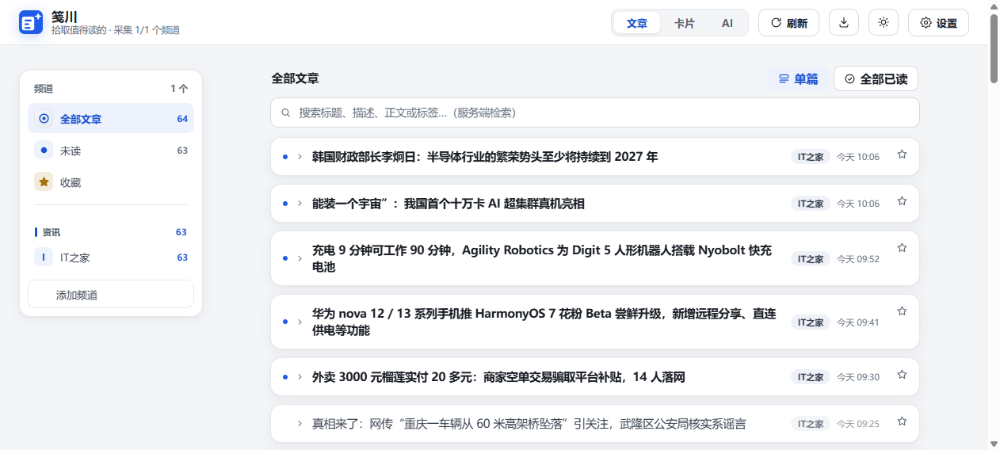
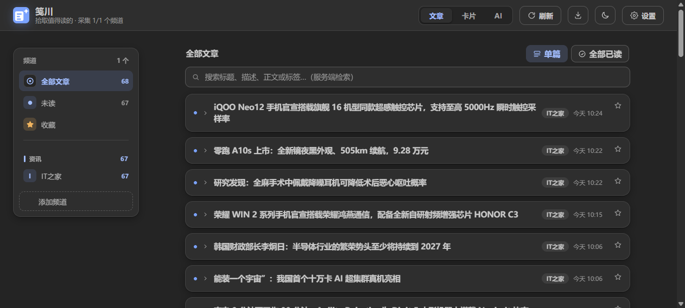
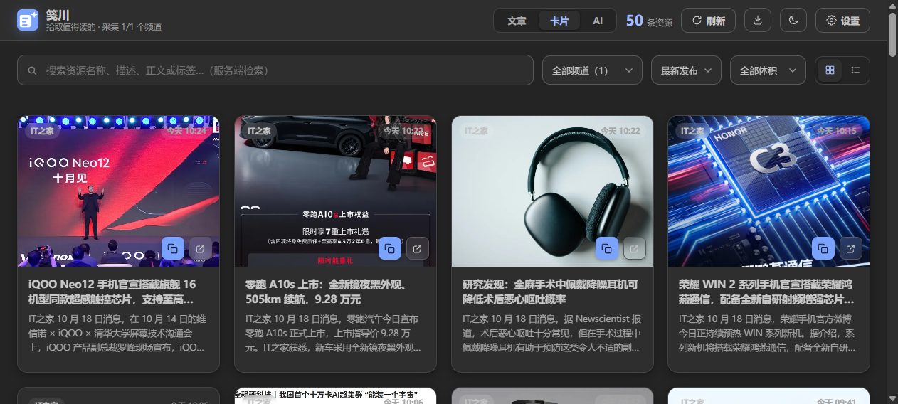
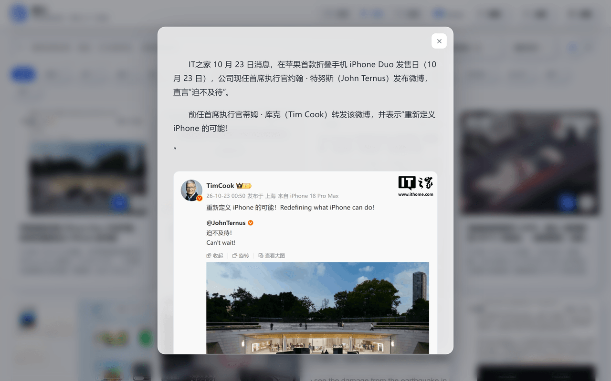
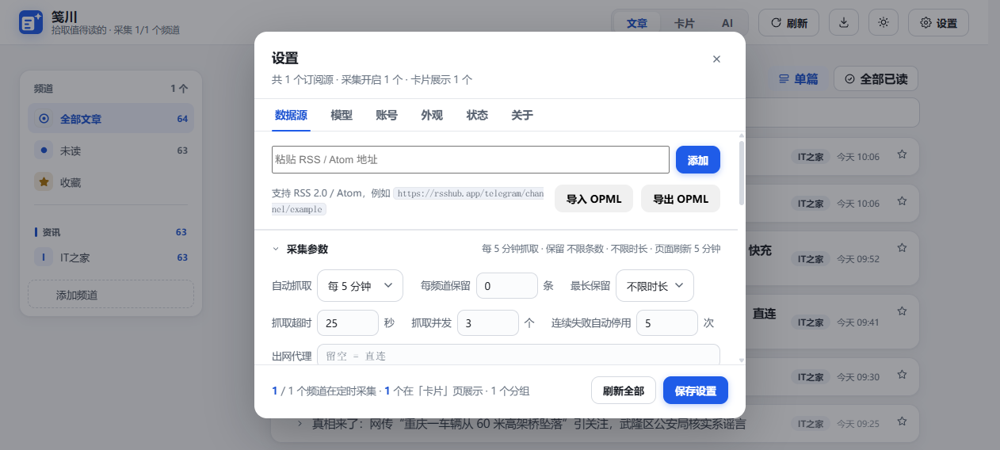
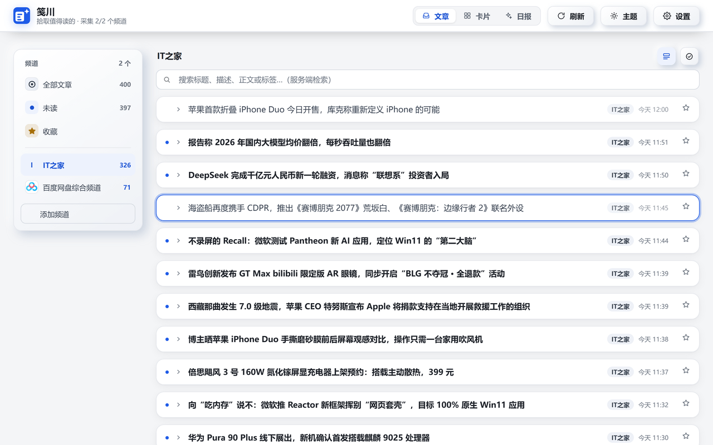
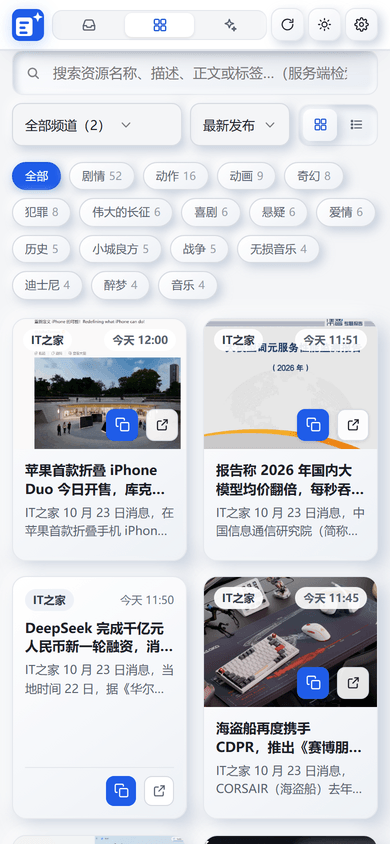
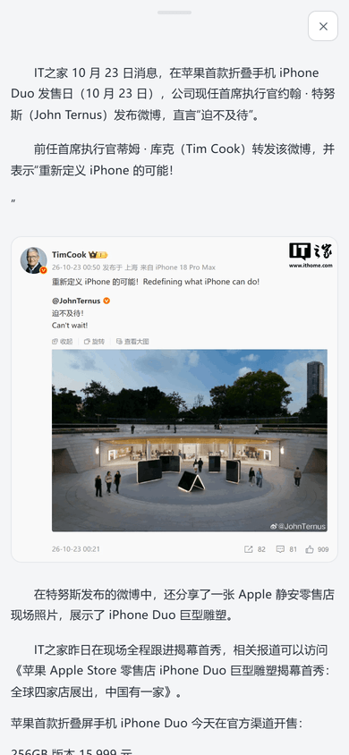

# 笺川 · FeedLore

> 拾取值得读的 —— 一个干净、顺手的**自托管 RSS 阅读器**，附资源卡片墙。多用户、无广告、无遥测，数据都在你自己的服务器上。

## 在线体验

**https://feedlore.669600.xyz** · 账户 `demo` / 密码 `demo`

演示账户是普通用户角色，功能全部可点；订阅源与已读状态会随真实使用变动，也可能随时重置。想试多用户隔离，就自己部署一份。

## 这是什么

笺川把「订阅 → 阅读 → 沉淀」收在一处：左边订阅源、右边文章，点开就地读全文；值得回头看的资源进卡片墙。所有数据存在你自己的 PostgreSQL 里，不经过任何第三方。

## 功能一览

- **专注阅读**：左频道（按分组）右文章，点标题就地展开全文；已读 / 未读 / 收藏齐全，顶部搜索走服务端检索，可开自动刷新。
- **图文原样呈现**：图片按原文顺序内联，统一经服务端代理加载，源站防盗链也不裂图。
- **订阅管理**：OPML 导入 / 导出（含分组、自动去重），频道重命名、**订阅地址可改**、分组重命名与拖拽排序，单频道可设抓取频率；抓取连续失败的频道会自动停用并提示。
- **卡片墙**：网格 / 列表展示资源卡片，可按频道、标签筛选与搜索，点卡片直接弹出详情看全文。
- **两个视图互相指路**：卡片详情里点「在文章页查看」，会切到文章页、滚到那一条并让它闪一下描边，不用自己在列表里翻。
- **条目过滤**：按关键词或正则设置「只收」或「屏蔽」，可选只匹配标题 / 摘要 / 正文；新抓取的条目入库前逐人生效，每个账号独立配置。
- **外观可定制**：4 套主题（跟随系统 / 浅色 / CommaFeed 暗色 / GitHub 暗黑）、6 套主色，字号 / 字体 / 行高 / 阅读宽度可调，即时生效。
- **多用户与角色**：每人独立订阅源 / 已读 / 收藏；**模型与日报配置都按账户绑定**，没有站点级默认值，谁也不会跑在别人选的模型上。
- **移动端当 App 用**：弹层一律整屏推入、可下拉手势关闭；HTTPS 下「添加到主屏幕」即可安装，外壳离线可开。
- **可选的 AI 日报**：在「设置 → 模型」填好自己的地址 / Key / 模型名，再在「设置 → 日报」设定自动生成时间、摘要范围与写作风格，即可按账号把过去 24 小时的新条目整理成中文简报；不配 Key 不影响任何其它功能。
- **自带更新通道**：「设置 → 关于」检查新版本，配合 Watchtower 可一键更新（推送 git tag 即发版）。

## 界面截图

| 文章阅读页（浅色） | 文章阅读页（暗色） |
| --- | --- |
|  |  |

| 卡片墙（浅色） | 卡片墙（暗色） |
| --- | --- |
|  |  |

| 卡片详情弹窗 | 数据源管理（分组 / 采集参数） |
| --- | --- |
|  |  |

| 从卡片页跳到文章页：滚到那条并闪一下描边 |
| --- |
|  |

| 手机端 · 卡片墙 | 手机端 · 整屏详情（可下拉关闭） |
| --- | --- |
|  |  |

## 快速开始

需要 **Docker（含 Compose）**。推荐**镜像模式**：拉 ghcr.io 预构建镜像，配 Watchtower 自动更新。

```bash
# 1. 克隆仓库（仅为了获取 .env.example 和 docker-compose.release.yml）
git clone https://github.com/chensnails/FeedLore.git
cd FeedLore

# 2. 创建环境配置文件
cp .env.example .env

# 3. ⚠️ 生成强随机数据库密码与更新令牌（切勿使用弱密码）
sed -i "s#^PG_PASSWORD=.*#PG_PASSWORD=$(tr -dc 'A-Za-z0-9' < /dev/urandom | head -c 32)#" .env
sed -i "s|^WATCHTOWER_HTTP_API_TOKEN=.*|WATCHTOWER_HTTP_API_TOKEN=$(openssl rand -hex 32)|" .env

# 4. 确认关键配置已正确写入，并保存好凭据
grep -E '^(PG_PASSWORD|WATCHTOWER_HTTP_API_TOKEN)=' .env

# 5. 启动（预构建镜像 + Watchtower）
docker compose -f docker-compose.release.yml up -d
```

打开 `http://<主机>:3210`，首次启动的默认账号是 **admin / admin**，登录后请到「设置 → 账号」改密码。

**上手两步**：①「设置 → 数据源」粘贴 RSS / Atom 添加频道，或导入 OPML；② 回「文章」页开始读。

## 多用户与角色

| 角色 | 权限 |
| --- | --- |
| **管理员** | 全部功能 + 用户管理、站点级设置（只剩采集参数与状态页） |
| **普通用户** | 自己的订阅源、外观、模型与日报配置 |

- 账号只由管理员创建，无开放注册。
- 不同用户订阅同一 URL 互不影响；频道 / 文章 / 已读 / 收藏均按账号隔离。
- **模型与日报没有站点级默认值**：每个账号都要在「设置 → 模型」自己填地址 / Key / 模型名，日报才会生成。从站点级配置升级过来的这一刻，旧的那一份不会替任何人兜底，各账号需自行填一次。

## 换成源码模式（二次开发）

两种部署模式的容器名 / 数据库卷 / 网络完全一致，可随时互切、数据零迁移。想改代码就直接构建：

```bash
git clone https://github.com/chensnails/FeedLore.git
cd FeedLore
cp .env.example .env

# ⚠️ 生成强随机数据库密码（切勿使用弱密码）
sed -i "s#^PG_PASSWORD=.*#PG_PASSWORD=$(tr -dc 'A-Za-z0-9' < /dev/urandom | head -c 32)#" .env

# 确认密码已更换，并保存好凭据
grep PG_PASSWORD .env

# 构建并启动
docker compose up -d --build
```

## 更新

镜像模式下升级是全自动的：作者推送 git tag → CI 出双架构镜像 → 你这边的 Watchtower 每 5 分钟拉一次并重启容器。不想等的话，到「设置 → 关于 → 检查更新」点「一键更新」立即触发（约 1~2 分钟，期间页面短暂不可用，登录态不受影响）。

源码模式升级：`git pull && docker compose up -d --build`。

## 在手机上用（PWA）

窄屏下弹层是整屏推入、支持下拉手势关闭，卡片墙与文章页共用一套筛选逻辑。HTTPS 下用浏览器「添加到主屏幕」即可安装成 App（外壳与静态资源走 Service Worker 缓存，`/api` 一律网络优先、不缓存数据，所以离线能打开界面但读不到新内容）；建议用反向代理挂域名与证书。

## 常见问题

- **图片裂图？** 图统一经服务端 `/api/img` 代理；大量裂图多半源站失效，可到「设置 → 状态」查看。
- **别人能看到我的订阅吗？** 不能，全部按账号隔离。
- **数据备份？** 备份 PostgreSQL 数据卷（`db` 服务）。
- **怎么知道有没有新版本？** 「设置 → 关于 → 检查更新」（向 GitHub 查最新 Release，结果缓存 10 分钟）。
- **端口占用？** 改 `.env` 的 `HOST_PORT` 后 `docker compose up -d`。
- **不想自己部署能先用吗？** 可以，上面的演示地址用 `demo / demo` 登录；但演示库会重置，长期用请自托管。
- **为什么不开放注册？** 定位是个人 / 小圈子自托管，账号由管理员在「设置 → 账号」创建。

## 配置（`.env`）

除端口与数据库外，其余项**首次启动后一律以页面「设置」为准**，再改 `.env` 不生效。关键变量见 `.env.example`；`.env` 不入库。

## 技术栈

后端 Node 22 原生 `http`（不引框架）+ PostgreSQL（`pg` 直连，无 ORM）；前端 Vite + React 19，视图与内核通过一个 `core` 单例桥接、共享状态驱动重绘；单容器部署，镜像同时出 amd64 / arm64。许可证：[MIT](LICENSE).

## 目录结构

```
FeedLore/
├── server.js                    # Node 原生 http 后端：路由分发、会话鉴权、抓取调度、API
├── db.js                       # PostgreSQL 直连（pg）：建表 / 迁移 / 查询
├── rss.js                      # RSS/Atom 抓取与解析、条件请求、连续失败自动停用
├── lib/
│   ├── filter.js               # 条目过滤规则（只收 / 屏蔽 / 正则），入库前逐人生效
│   ├── opml.js                 # OPML 解析（导入）与导出拼装
│   └── prefs.js                # 用户偏好 / 过滤规则 / 日报配置清洗
├── digest.js                   # AI 日报生成（调用各账号自配模型）
├── proxy.js                    # 开发态反向代理辅助
├── docker-compose.release.yml  # 镜像模式部署（ghcr + Watchtower）
├── docker-compose.yml          # 源码构建模式部署
├── deploy.sh                   # 源码模式一键拉取重建 + 健康检查 + 启动期错误扫描
├── Dockerfile                  # 多阶段构建，同时出 amd64 / arm64
├── .env.example                # 配置样例（不入库）
├── public/                     # 构建产物与静态资源、PWA（sw.js / manifest.json / style.css）
├── src/
│   ├── core/                   # 内核单例 core：状态、宿主桥、引导、PWA 安装
│   ├── shell/                  # 顶栏与整体框架
│   ├── views/                  # 文章页、卡片墙、卡片详情、下拉等视图
│   ├── settings/               # 设置模态：数据源 / 模型 / 日报 / 账号 / 外观 / 状态 / 关于
│   ├── ui/                     # 弹层、Toast、灯箱等通用 UI
│   ├── ai/                     # AI 日报视图
│   └── cmdk/                   # 命令面板
├── tests/                      # UI 回归 + 服务端单测 / 部署守卫
└── docs/                       # 截图等文档资源
```

## API 接口

除 `/api/health`、`/api/login`、`/api/logout`、`/api/session` 外，其余接口均需登录（会话 Cookie）；标注「管理员」的还需管理员角色。所有请求与响应均为 JSON。

**接口一览**

| 分组 | 接口 | 说明 | 权限 |
| --- | --- | --- | --- |
| 鉴权/版本 | `GET /api/health` | 健康检查 | 公开 |
| | `POST /api/login` · `POST /api/logout` | 登录 / 登出 | 登录 |
| | `GET /api/session` | 当前登录态 | 公开 |
| | `GET /api/version` · `POST /api/version/check` | 版本 / 查 GitHub 最新版（缓存 10 分钟） | 登录 |
| | `POST /api/update` | 一键更新（转发 Watchtower） | 管理员 |
| 订阅源 | `GET/POST /api/feeds` · `POST /api/feeds/import` · `POST /api/feeds/reorder` | 列表 / 新增 / OPML 导入 / 拖拽排序 | 登录 |
| | `GET/POST/PATCH/DELETE /api/feeds/:id` | 查看 / 刷新 / 改（地址·分组·标题·频率·开关）/ 删除 | 登录 |
| 条目 | `GET /api/entries`（支持 `q`/`feed`/`tag`/`unread`/`fav`） | 列表与搜索 | 登录 |
| | `GET /api/entries/flags` · `POST /api/entries/read-all` | 标记态 / 全部已读 | 登录 |
| | `GET/PATCH /api/entries/:id` · `GET /api/img` | 正文 / 标记已读收藏 / 图片代理 | 登录 |
| 设置/用户 | `GET/POST /api/config` · `GET /api/status` | 站点采集参数 / 状态页 | 管理员 |
| | `GET/POST /api/users` · `PATCH/DELETE /api/users/:id` | 用户列表·创建 / 改角色密码·删除 | 管理员 |
| | `GET/POST /api/prefs` · `POST /api/account` | 本账号偏好（含模型/日报）/ 改自己用户名密码 | 登录 |
| | `GET/POST /api/image-cache` · `/api/image-cache/clear` | 图片缓存状态 / 清理 | 管理员 |
| AI 日报 | `GET /api/digests` · `GET /api/digest?date=` · `POST /api/digest/generate` · `POST /api/digest/test-llm` | 历史列表 / 单篇 / 生成 / 测连通 | 登录 |

## 使用示例

健康检查：

```bash
curl http://localhost:3210/api/health
# => {"ok":true,"authed":false,"db":{"ready":true,...}}
```

登录并复用会话（后续请求带 `-b cookies.txt`）：

```bash
curl -c cookies.txt -X POST http://localhost:3210/api/login \
  -H 'Content-Type: application/json' \
  -d '{"username":"admin","password":"admin"}'
```

查看订阅源、查更新、触发一键更新：

```bash
curl -b cookies.txt http://localhost:3210/api/feeds
curl -b cookies.txt -X POST http://localhost:3210/api/version/check
curl -b cookies.txt -X POST http://localhost:3210/api/update
```

OPML 备份在页面内完成：进入「设置 → 数据源」点「导出 OPML」，或用命令面板（Ctrl/Cmd+K）搜「导出 OPML」，浏览器会下载 `feedlore-subscriptions-日期.opml`。
